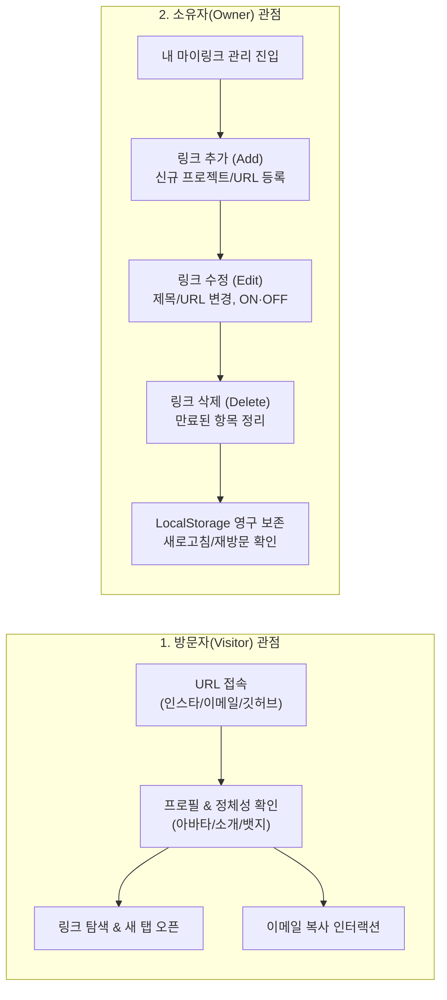

# [PRD] 마이링크 (MyLink) 제품 요구사항 정의서

- **제품명**: 마이링크 (MyLink)
- **문서 버전**: v1.3.0 (방문자 vs 소유자 관점 시나리오 고도화)
- **작성일자**: 2026-11-09
- **문서 상태**: 확정 (Approved for Live Demo)
- **핵심 목표**: **브라우저 로컬스토리지(LocalStorage)를 활용한 프로필 페이지 단일 뷰 완성**

---

## 1. 프로젝트 배경 및 시연 전략 (Context & Demo Strategy)

### 1.1 시연 목적 (Live Demonstration Goal)
본 프로젝트는 **"Next.js와 브라우저 로컬스토리지를 활용해 나만의 링크트리 서비스를 점진적으로 만들어가는 라이브 시연"**을 위해 기획되었습니다.

한 번에 모든 복잡한 기능(대시보드, 통계, 백엔드)을 구축하지 않고, **가장 핵심이 되는 프로필 페이지가 로컬스토리지와 어떻게 연동되는지**를 먼저 시연하고 검증하는 **단계별(Step-by-Step) 접근**을 취합니다.

### 1.2 시연 범위 정의 (Scope Boundaries)

| 구분 | 포함 여부 | 주요 내용 |
|---|:---:|---|
| **현재 시연 범위 (In-Scope)** | **✅ 필수** | • 브라우저 `localStorage` 기반 프로필 & 링크 데이터 읽기/쓰기<br>• 최초 방문 시 기본 샘플 데이터 자동 초기화 (Auto-seeding)<br>• Next.js App Router 기반의 SSR Hydration-safe 렌더링<br>• 모바일 반응형 프로필 카드 UI (TDS 스타일 적용)<br>• 이메일 클립보드 복사 피커 & 외부 링크 새 탭 이동 인터랙션 |
| **추후 단계 범위 (Deferred / Out-of-Scope)** | **⏳ 차기 단계** | • 관리자 대시보드 편집기 (링크 추가/수정 폼, 드래그 앤 드롭 등)<br>• 방문자 및 링크 클릭 통계(Analytics) 분석 지표<br>• 테마 실시간 변경 커스텀 피커<br>• JSON 데이터 내보내기/가져오기 백업 모듈 |

---

## 2. [Phase 1: 현재 시연] 로컬스토리지 프로필 페이지 요구사항

### 2.1 [FR-01] 로컬스토리지 연동 엔진 (Storage Engine)
1. **스토리지 키 정의**:
   - `mylink_profile_data` 단일 키에 JSON 객체 형태로 프로필과 링크 목록 저장.
2. **최초 접속 시 자동 시딩(Auto-Seeding)**:
   - 브라우저 로컬스토리지를 조회하여 데이터가 없을 경우, 기본 샘플 데이터(기본 이름, 소개글, 아바타, 3개 기본 링크)를 즉시 저장.
3. **SSR Hydration Mismatch 방지**:
   - Next.js 서버 렌더링 시점과 브라우저 마운트 시점의 불일치를 방지하기 위해 마운트 완료(`isMounted`) 후 안전하게 로컬스토리지 값 동기화.

### 2.2 [FR-02] 프로필 페이지 뷰 (Profile View Components)
1. **프로필 헤더 영역**:
   - 아바타 이미지 (원형 마스크 및 fallback 처리)
   - 온라인 상태 표시 인디케이터
   - 사용자 이름 (`displayName`) 및 핸들 (`@username`)
   - 소개 문구 (`bio`)
   - 관심사/역할 뱃지 칩 목록
2. **액션 버튼 영역**:
   - 이메일 복사하기 (클릭 시 클립보드 복사 + 피드백 토스트/문구 전환)
   - 소셜 프로필(GitHub 등) 바로가기 버튼
3. **링크 목록 영역 (`list-row`)**:
   - 로컬스토리지에 저장된 활성화(`isActive: true`) 링크들을 순서대로 출력
   - 각 링크 카드: 좌측 전용 아이콘 + 제목 + 서브 설명 + 우측 화살표(Chevron)
   - 링크 클릭 시 새 탭(`target="_blank"`)으로 안전하게 오픈
4. **푸터 영역**:
   - 저작권 문구 및 로컬스토리지 연동 안내 표기

---

## 3. 데이터 스키마 명세 (Data Schema)

로컬스토리지 키 `mylink_profile_data`에 저장되는 단일 JSON 구조입니다.

```typescript
export interface LinkItem {
  id: string;
  title: string;
  url: string;
  description?: string;
  icon?: 'github' | 'mail' | 'web';
  isActive: boolean;
}

export interface MyLinkProfileData {
  username: string;       // 예: "seoyeonkim-glitch"
  displayName: string;    // 예: "김서연"
  bio: string;            // 소개 문구
  avatarUrl: string;      // 아바타 이미지 주소
  tags: string[];         // 뱃지 태그 배열
  socialLinks: {
    github?: string;
    email?: string;
  };
  links: LinkItem[];      // 링크 목록
  updatedAt: string;      // ISO 8601 타임스탬프
}
```

---

## 4. 핵심 사용자 시나리오 (Two Core Perspectives)

마이링크는 **① 다른 사람의 링크를 소비하는 [방문자(Visitor)]**와 **② 자신의 링크를 관리하는 [소유자(Owner)]**의 두 가지 명확한 관점에서 시나리오를 정의합니다.



---

### 4.1 관점 1: 방문자 (Visitor) 시나리오
> **"다른 사람의 마이링크 페이지를 방문하여 탐색하고 소통하는 과정"**

- **액터(Actor)**: 인스타그램 바이오, 채용 서류, GitHub 프로필 링크 등을 통해 마이링크를 방문한 외부 사용자 (채용 담당자, 팬, 동료 등)
- **주요 목표**: 링크 소유자가 누구인지 직관적으로 파악하고, 원하는 외부 링크로 빠르고 안전하게 이동하며, 연락처를 손쉽게 확보한다.

| 단계 | 행동 및 인터랙션 | 시스템 반응 및 기대 효과 |
|:---:|---|---|
| **Step 1: 페이지 진입 및 정체성 파악** | 사용자가 모바일/데스크톱 브라우저로 마이링크 URL에 접속한다. | • 깔끔한 TDS 디자인의 프로필 카드 즉각 로드<br>• 원형 아바타, 녹색 'ONLINE' 뱃지, 이름(`김서연`), 한 줄 소개, 태그 칩(`바이브 코딩`, `대학생`, `성장 중`, `Next.js`)을 통해 3초 안에 소유자의 정체성 파악 |
| **Step 2: 주요 링크 탐색** | 프로필 하단에 정렬된 링크 카드 목록을 위에서 아래로 스캔한다. | • 각 링크마다 의미에 맞는 전용 아이콘(GitHub, 메일, 웹 등)과 상세 설명(`my-link-hy 코드 둘러보기`)이 함께 표기되어 클릭 전 목적지를 명확히 인지 |
| **Step 3: 외부 링크 이동 (새 탭)** | 관심 있는 `GitHub 저장소` 또는 `포트폴리오` 링크 카드를 터치/클릭한다. | • `target="_blank"` 및 `rel="noopener noreferrer"`로 새 브라우저 탭에서 대상 페이지 오픈<br>• 원래 마이링크 페이지를 잃어버리지 않고 유지하여 다른 링크도 이어서 탐색 가능 |
| **Step 4: 연락처 복사 (원클릭)** | 협업 문의를 위해 상단의 `[이메일로 연락하기]` 버튼을 클릭한다. | • 브라우저 클립보드에 이메일(`seoyeonkim@hanyang.ac.kr`)이 자동 복사됨<br>• 버튼 문구가 `이메일 복사됐어요 ✓`로 즉시 변경되어 성공 피드백을 전달하고 2초 후 원복 |
| **Step 5: 모바일 쾌적성 경험** | 스마트폰(iPhone SE, 갤럭시 등 320~375px 소형 화면)에서 한 손으로 조작한다. | • 긴 링크 제목이나 이메일도 가로 스크롤 없이 말줄임(`ellipsis`)으로 깔끔히 정돈<br>• 모든 버튼이 최소 44px 이상의 터치 타깃을 확보하여 오터치 없이 편안하게 이용 |

---

### 4.2 관점 2: 소유자 (Owner) 시나리오
> **"자신의 마이링크를 직접 관리하는 과정 (링크 추가, 수정, 삭제, 보존)"**

- **액터(Actor)**: 자신의 포트폴리오, SNS, 프로젝트 링크를 하나의 페이지로 관리하고 브랜딩하려는 크리에이터/개발자
- **주요 목표**: 별도의 서버/DB 로그인 없이도 내 브라우저에서 링크를 자유롭게 추가·수정·삭제하고, 브라우저를 닫아도 데이터가 안전하게 유지되도록 관리한다.

#### 1) 링크 추가 (Add Link) 시나리오
1. **상황**: 새로운 사이드 프로젝트를 배포하여 내 마이링크 목록에 새로 노출하고 싶다.
2. **동작**:
   - 제목(Title: `"새로운 토이프로젝트"`), URL(`"https://my-toy.dev"`), 설명(`"Next.js로 만든 미니 서비스"`)을 입력하고 [추가]를 실행한다.
   - 시스템은 고유 ID(예: `link-4`)를 생성하고 `isActive: true` 상태로 `mylink_profile_data`의 `links` 배열 끝에 추가한다.
3. **결과**:
   - 브라우저 로컬스토리지에 즉시 동기화되며, 화면 목록에 새 링크 카드가 즉시 렌더링된다.

#### 2) 링크 수정 (Edit Link) 시나리오
1. **상황**: 기존 링크의 제목을 변경하거나(예: `"개발자 포트폴리오 2025"` → `"개발자 포트폴리오 2026"`), 링크 URL에 오타가 있어 수정해야 한다.
2. **동작**:
   - 링크 항목의 제목이나 URL 텍스트를 인라인으로 수정한다.
   - 필요 시 임시로 숨기고 싶을 때는 [ON/OFF 토글 스위치]를 꺼서 `isActive: false`로 바꾼다.
3. **결과**:
   - 로컬스토리지의 해당 링크 객체 속성이 즉각 갱신되며, 방문자 뷰에서는 비활성화된 링크가 보이지 않게 처리된다.

#### 3) 링크 삭제 (Delete Link) 시나리오
1. **상황**: 더 이상 운영하지 않거나 종료된 이전 이벤트 링크를 목록에서 완전히 정리하고 싶다.
2. **동작**:
   - 해당 링크 카드의 [삭제(휴지통)] 아이콘을 클릭한다.
   - 삭제 확인 후, 시스템은 `links` 배열에서 해당 ID를 가진 항목을 필터링(`filter`)하여 제외한다.
3. **결과**:
   - 로컬스토리지에서 해당 데이터가 즉시 삭제되고, 화면에서도 매끄럽게 사라진다.

#### 4) 데이터 영속성 검증 (Persistence & Peace of Mind)
1. **상황**: 링크를 추가, 수정, 삭제한 후 컴퓨터를 끄거나 브라우저 탭을 닫았다가 내일 다시 접속한다.
2. **동작**:
   - 브라우저를 재실행하고 마이링크에 접속한다.
   - `useEffect` 훅이 마운트 시점에 로컬스토리지의 `mylink_profile_data`를 조회한다.
3. **결과**:
   - 어제 내가 추가하고 수정한 모든 링크와 프로필 설정이 단 1개의 손실도 없이 100% 온전히 유지되어 화면에 로드된다.

---

## 5. 단계별 개발 로드맵 (Roadmap)

| 단계 | 목표 | 주요 내용 | 상태 |
|:---:|---|---|:---:|
| **Phase 1** | **로컬스토리지 프로필 페이지** | • 로컬스토리지 연동 및 자동 시딩<br>• SSR 안전한 렌더링<br>• TDS 스타일 반응형 프로필 단일 뷰 | **🎯 현재 시연** |
| **Phase 2** | **실시간 편집 대시보드** | • 프로필/링크 인라인 편집 UI<br>• 링크 활성화 ON/OFF 스위치<br>• 드래그 앤 드롭(DnD) 순서 재배치 | ⏳ 차기 단계 |
| **Phase 3** | **테마 커스텀 엔진** | • 6종 감성 프리셋 테마 원클릭 변경<br>• 버튼 모양/배경색 피커 연동 | ⏳ 차기 단계 |
| **Phase 4** | **로컬 통계 & 백업** | • 페이지 조회수, 링크별 클릭 수(CTR) 카운터<br>• JSON Export / Import 백업 모듈 | ⏳ 차기 단계 |
