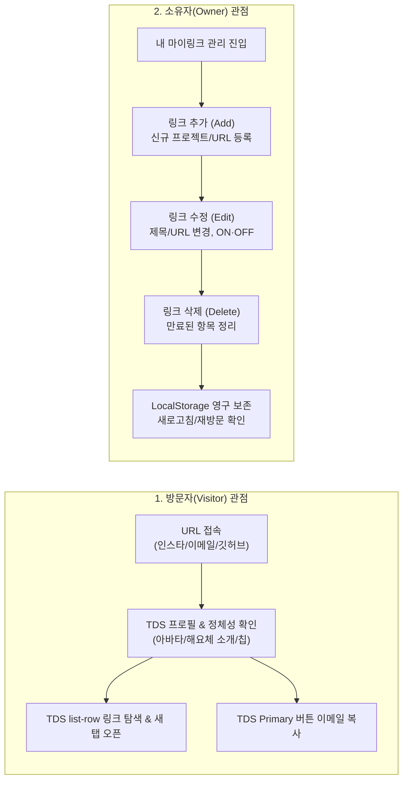

# [PRD] 마이링크 (MyLink) 제품 요구사항 정의서

- **제품명**: 마이링크 (MyLink)
- **문서 버전**: v1.5.0 (shadcn/ui 기반 토스 디자인 시스템(TDS) 통합 명세)
- **작성일자**: 2026-11-09
- **문서 상태**: 확정 (Approved for Live Demo)
- **핵심 목표**: **브라우저 로컬스토리지(LocalStorage)를 활용한 프로필 페이지 단일 뷰 완성**
- **디자인 시스템**: **shadcn/ui 컴포넌트 아키텍처 × 토스 디자인 시스템(TDS, `DESIGN.md`) 통합 표준**

---

## 1. 프로젝트 배경 및 시연 전략 (Context & Demo Strategy)

### 1.1 시연 목적 (Live Demonstration Goal)
본 프로젝트는 **"Next.js와 브라우저 로컬스토리지를 활용해 나만의 링크트리 서비스를 점진적으로 만들어가는 라이브 시연"**을 위해 기획되었습니다.

한 번에 모든 복잡한 기능(대시보드, 통계, 백엔드)을 구축하지 않고, **가장 핵심이 되는 프로필 페이지가 로컬스토리지와 어떻게 연동되는지**를 먼저 시연하고 검증하는 **단계별(Step-by-Step) 접근**을 취합니다.

### 1.2 시연 범위 정의 (Scope Boundaries)

| 구분 | 포함 여부 | 주요 내용 |
|---|:---:|---|
| **현재 시연 범위 (In-Scope)** | **✅ 필수** | • 브라우저 `localStorage` 기반 프로필 & 링크 데이터 읽기/쓰기<br>• 최초 방문 시 기본 샘플 데이터 자동 초기화 (Auto-seeding)<br>• Next.js App Router 기반의 SSR Hydration-safe 렌더링<br>• **shadcn/ui 기반 재사용 컴포넌트 구조 (`Button`, `Card`, `Badge`, `Separator` 등)**<br>• **토스 디자인 시스템(TDS) 스타일 가이드라인 (`DESIGN.md`) 100% 준수**<br>• 모바일 반응형 프로필 카드 UI (Tailwind CSS v4 스타일링)<br>• 이메일 클립보드 복사 피커 & 외부 링크 새 탭 이동 인터랙션 |
| **추후 단계 범위 (Deferred / Out-of-Scope)** | **⏳ 차기 단계** | • 관리자 대시보드 편집기 (링크 추가/수정 폼, 드래그 앤 드롭 등)<br>• 방문자 및 링크 클릭 통계(Analytics) 분석 지표<br>• 테마 실시간 변경 커스텀 피커<br>• JSON 데이터 내보내기/가져오기 백업 모듈 |

---

## 2. 디자인 시스템: shadcn/ui × 토스 디자인 시스템(TDS) 통합 명세

모든 UI 컴포넌트는 **shadcn/ui의 표준 프리미티브 컴포넌트 아키텍처**를 기반으로 하되, 비주얼과 인터랙션은 **토스 디자인 시스템(TDS, `DESIGN.md`)의 핵심 토큰 및 규칙**을 엄격히 적용하여 구축합니다.

### 2.1 TDS 핵심 디자인 원칙 (TDS Principles)
1. **단일 강조색 정책 (Single Blue Accent)**:
   - 강조색은 **`blue-500` (`#3182F6`)** 단 하나만 사용합니다.
   - 메인 화면당 Primary CTA(핵심 행동 유도 버튼)는 **오직 1개**로 제한합니다.
2. **평면적이고 정갈한 표면 (Flat & Clean Surface)**:
   - 화려한 그라디언트나 무거운 드롭섀도우를 배제합니다.
   - 페이지 배경(`grey-100`), 카드 컨테이너(`white`), 구분선(`grey-200`)의 담백한 면 분할을 유지합니다.
3. **공격적이고 부드러운 곡률 (Radical Border Radius)**:
   - 카드 컨테이너: **24px** (`rounded-[24px]`)
   - 주요 버튼 (L/Primary/Secondary): **14px** (`rounded-[14px]`)
   - 칩 뱃지 및 아바타: **999px** (`rounded-full`)
4. **해요체 카피라이팅 & 명확한 동사형 액션**:
   - 모든 사용자 문구는 신뢰감과 친근감을 전달하는 **"해요체"**를 사용합니다. (예: `~개발자예요`, `친구와 동료에게 전달해요`)
   - 버튼 문구는 **"일어날 일을 직접 말한다"**는 원칙에 따라 명확한 동사로 표현합니다. (예: `이메일로 연락하기`, `GitHub 방문하기`)
5. **표준 list-row 패턴**:
   - 각 링크 아이템은 TDS의 `list-row` 표준 규격(좌측 전용 아이콘 뱃지 + 중앙 타이틀/디스크립션 + 우측 chevron 아이콘 + 터치 시 부드러운 반응)을 따릅니다.
6. **Tailwind CSS 단일 스타일링 표준 (Tailwind CSS Only)**:
   - 페이지 및 모든 컴포넌트 스타일은 CSS Module(`.module.css`), `<style jsx>`, 인라인 `style` 속성을 배제하고 **Tailwind CSS(v4) 유틸리티 클래스로 100% 통일**합니다.

### 2.2 TDS 핵심 디자인 토큰 (`DESIGN.md` 기준)

| 구분 | 토큰명 | 값 / 규격 | 용도 및 규칙 |
|---|---|---|---|
| **색상 (Color)** | `blue-500` | `#3182F6` | **Primary CTA**, 핵심 액센트 (화면당 1개) |
| | `blue-50` | `#E8F3FF` | Brand Weak 배경, 선택된 칩 뱃지 배경 |
| | `grey-900` | `#191F28` | Primary 텍스트 (이름, 카드 타이틀) |
| | `grey-700` | `#4E5968` | Secondary 텍스트 (소개글, 링크 설명) |
| | `grey-500` | `#8B95A1` | 핸들명(`@handle`), 섹션 라벨, 부가 정보 |
| | `grey-200` | `#E5E8EB` | 표준 구분선(Divider), 테두리 |
| | `grey-100` | `#F2F4F6` | Secondary 표면, 기본 칩 배경, 페이지 배경 |
| | `white` | `#FFFFFF` | 메인 프로필 카드 배경 |
| | `green-500` | `#34C759` | 실시간 온라인 상태 점(dot) |
| **타이포그래피** | Pretendard | Variable | TPS 대체 서체, 자간 `-0.005em ~ -0.015em` |
| **라운드** | Card / Button | `24px` / `14px` | 극대화된 모바일 친화 라운드 |

### 2.3 shadcn/ui 프리미티브 컴포넌트 커스텀 매핑

| 컴포넌트 | 파일 경로 | TDS 스타일 커스텀 상세 |
|---|---|---|
| **`Button`** | `@/components/ui/button.tsx` | • **default**: `bg-[#3182F6] hover:bg-[#1B64DA] text-white rounded-[14px] h-[52px] font-bold text-[17px] active:scale-[0.98]`<br>• **secondary**: `bg-[#F2F4F6] hover:bg-[#E5E8EB] text-[#191F28] rounded-[14px] h-[52px] font-bold text-[17px] active:scale-[0.98]` |
| **`Card`** | `@/components/ui/card.tsx` | • **컨테이너**: `bg-white rounded-[24px] border-none shadow-none overflow-hidden`<br>• **list-row 항목**: `hover:bg-[#F2F4F6] rounded-[16px] transition-colors p-3.5 flex items-center gap-[14px]` |
| **`Badge`** | `@/components/ui/badge.tsx` | • **default**: `bg-[#F2F4F6] text-[#4E5968] rounded-full h-[30px] px-3 font-semibold text-[13px]`<br>• **brand**: `bg-[#E8F3FF] text-[#3182F6] rounded-full h-[30px] px-3 font-semibold text-[13px]` |
| **`Avatar`** | `@/components/ui/avatar.tsx` | • `80x80px` 원형 아바타 (`rounded-full bg-[#F2F4F6]`) 및 이미지 로드 실패 시 `fallbackSrc` 자동 대체 |
| **`Separator`** | `@/components/ui/separator.tsx` | • TDS 표준 구분선: `bg-[#E5E8EB] h-[1px] w-full my-0` |
| **`Toast`** | `@/components/ui/toast.tsx` | • 이메일/링크 복사 시 피드백: "이메일 복사됐어요 ✓" 토스트 알림 |

### 2.4 shadcn/ui 기반 재사용 도메인 컴포넌트 (`src/components/profile/`)

| 컴포넌트 | 파일 경로 | 구성 및 역할 |
|---|---|---|
| **`ProfileHeader`** | `@/components/profile/ProfileHeader.tsx` | • `Avatar`, `Badge`를 조합하여 아바타, 실시간 온라인 인디케이터, 이름/핸들/소개글, 관심사 태그 칩 렌더링 |
| **`ProfileActions`** | `@/components/profile/ProfileActions.tsx` | • `Button`(`default`, `secondary`)을 조합하여 이메일 복사 Primary CTA 및 GitHub 방문 버튼 렌더링 |
| **`LinkCardItem`** | `@/components/profile/LinkCardItem.tsx` | • `CardListRow`, `CardTitle`, `CardDescription`을 조합하여 개별 링크 아이템 렌더링 |
| **`LinkListSection`** | `@/components/profile/LinkListSection.tsx` | • 활성 링크 목록(`LinkCardItem`)과 프로필 공유하기 로우를 묶어 렌더링 |

---

## 3. [Phase 1: 현재 시연] 로컬스토리지 프로필 페이지 요구사항

### 3.1 [FR-01] 로컬스토리지 연동 엔진 (Storage Engine)
1. **스토리지 키 정의**:
   - `mylink_profile_data` 단일 키에 JSON 객체 형태로 프로필과 링크 목록 저장.
2. **최초 접속 시 자동 시딩(Auto-Seeding) 및 Mock API 데이터 활용**:
   - 브라우저 로컬스토리지를 조회하여 데이터가 없을 경우, **4.2절에 정의된 백엔드 Mock API용 기본 더미 데이터(5개 링크 항목)**를 기반으로 즉시 초기화.
3. **SSR Hydration Mismatch 방지**:
   - Next.js 서버 렌더링 시점과 브라우저 마운트 시점의 불일치를 방지하기 위해 마운트 완료(`isMounted`) 후 안전하게 로컬스토리지 값 동기화.

### 3.2 [FR-02] TDS × shadcn/ui 프로필 페이지 뷰 (Profile View Components)
1. **프로필 헤더 영역 (`ProfileHeader`)**:
   - 상단 바: 좌측 `MyLink` 브랜드 로고 + 우측 원형 공유 아이콘 `Button` (`variant="iconCircle"`, `ArrowUpRight`)
   - 아바타 이미지 (`Avatar`, `AvatarImage` 원형 마스크 82px 및 fallback 처리)
   - 사용자 이름 (`displayName`, 20px/Bold) 및 소개 문구 (`bio`, 13px/Regular, 해요체)
2. **소셜 퀵 액션 영역 (`ProfileActions`)**:
   - **shadcn `Button` (`iconCircle` variant)**: 블로그, 포트폴리오, GitHub, 이메일 복사 등 4개의 원형 퀵 액션 아이콘 버튼 가로 배치
   - 이메일 아이콘 클릭 시 클립보드 복사 + 하단 `Toast`("이메일 복사됐어요 ✓") 피드백 제공
3. **카테고리별 링크 목록 영역 (`LinkListSection` & `LinkCardItem`)**:
   - 카테고리 헤더(`🚀 주요 프로젝트`, `📚 기술 & 블로그`) + 우측 개수 카운트 **`Badge` (`variant="count"`)** + **`Separator`** 구분선
   - **shadcn `Card` (`CardListRow`)** 기반으로 활성화(`isActive: true`)된 링크들을 독립된 테두리 카드 형태로 출력
   - 각 링크 카드: 좌측 전용 아이콘 박스 + 중앙 제목 및 상태 **`Badge` (`HOT`, `추천`, `NEW`)** + 서브 설명 + 우측 액션 **`Badge` (`보기`, `다운로드`, `방문`, `읽기`)** 및 Chevron 화살표
   - 링크 클릭 시 새 탭(`target="_blank"`)으로 안전하게 오픈
4. **푸터 영역**:
   - TDS `caption` 스타일의 저작권 문구 및 로컬스토리지 연동 표기

---

## 4. 데이터 스키마 및 더미 데이터 명세 (Data Schema & Dummy Data)

### 4.1 데이터 스키마 (TypeScript Interface)

로컬스토리지 키 `mylink_profile_data` 및 백엔드 Mock API 응답에서 사용하는 데이터 구조입니다.

```typescript
export interface LinkItem {
  id: string;
  userId?: string;
  title: string;
  url: string;
  description?: string;
  category?: 'SOCIAL' | 'PROJECT' | 'BLOG' | 'PORTFOLIO' | 'CONTACT';
  icon?: 'github' | 'mail' | 'web';
  order?: number;
  isActive: boolean;
  clickCount?: number;
  createdAt?: string;
  updatedAt?: string;
}

export interface MyLinkProfileData {
  username: string;       // 예: "seoyeonkim-glitch"
  displayName: string;    // 예: "김서연"
  bio: string;            // 소개 문구 (해요체)
  avatarUrl: string;      // 아바타 이미지 주소
  tags: string[];         // 뱃지 태그 배열
  socialLinks: {
    github?: string;
    email?: string;
  };
  links: LinkItem[];      // 링크 목록
  updatedAt: string;      // ISO 8601 타임스탬프
}
```

### 4.2 백엔드 Mock API 및 초기 시딩용 링크 더미 데이터

링크 목록 조회(`GET /api/links`) Mock API 및 초기 로컬스토리지 시딩에 사용하는 표준 더미 데이터입니다.

#### 1) 리소스 객체 배열 형태
```json
[
  {
    "id": "550e8400-e29b-41d4-a716-446655440001",
    "userId": "user_seoyeon_01",
    "title": "GitHub 프로필",
    "url": "https://github.com/seoyeonkim-glitch",
    "description": "진행 중인 프로젝트와 잔디를 확인해요",
    "category": "SOCIAL",
    "icon": "github",
    "order": 1,
    "isActive": true,
    "clickCount": 142,
    "createdAt": "2026-11-01T09:00:00.000Z",
    "updatedAt": "2026-11-08T12:30:00.000Z"
  },
  {
    "id": "550e8400-e29b-41d4-a716-446655440002",
    "userId": "user_seoyeon_01",
    "title": "마이링크 (MyLink) 저장소",
    "url": "https://github.com/seoyeonkim-glitch/my-link-hy",
    "description": "Next.js와 TDS로 만든 나만의 링크 서비스예요",
    "category": "PROJECT",
    "icon": "github",
    "order": 2,
    "isActive": true,
    "clickCount": 89,
    "createdAt": "2026-11-03T14:30:00.000Z",
    "updatedAt": "2026-11-09T10:15:00.000Z"
  },
  {
    "id": "550e8400-e29b-41d4-a716-446655440003",
    "userId": "user_seoyeon_01",
    "title": "기술 블로그 (Velog)",
    "url": "https://velog.io/@seoyeonkim-glitch",
    "description": "바이브 코딩과 프론트엔드 개발 기록을 남겨요",
    "category": "BLOG",
    "icon": "web",
    "order": 3,
    "isActive": true,
    "clickCount": 64,
    "createdAt": "2026-11-05T18:20:00.000Z",
    "updatedAt": "2026-11-06T09:00:00.000Z"
  },
  {
    "id": "550e8400-e29b-41d4-a716-446655440004",
    "userId": "user_seoyeon_01",
    "title": "포트폴리오 노션",
    "url": "https://notion.so/seoyeonkim-portfolio",
    "description": "지금까지 만든 웹 프로덕트와 이력을 모았어요",
    "category": "PORTFOLIO",
    "icon": "web",
    "order": 4,
    "isActive": true,
    "clickCount": 215,
    "createdAt": "2026-11-07T11:15:00.000Z",
    "updatedAt": "2026-11-09T15:40:00.000Z"
  },
  {
    "id": "550e8400-e29b-41d4-a716-446655440005",
    "userId": "user_seoyeon_01",
    "title": "이메일로 문의하기",
    "url": "mailto:seoyeonkim@hanyang.ac.kr",
    "description": "협업이나 커피챗 제안은 언제든 환영해요",
    "category": "CONTACT",
    "icon": "mail",
    "order": 5,
    "isActive": false,
    "clickCount": 19,
    "createdAt": "2026-11-09T20:00:00.000Z",
    "updatedAt": "2026-11-09T20:00:00.000Z"
  }
]
```

#### 2) 공통 응답 래퍼 포함 형태 (REST API Response Envelope)
```json
{
  "status": 200,
  "success": true,
  "message": "링크 목록을 성공적으로 불러왔어요.",
  "meta": {
    "totalCount": 5,
    "activeCount": 4
  },
  "data": [
    {
      "id": "550e8400-e29b-41d4-a716-446655440001",
      "userId": "user_seoyeon_01",
      "title": "GitHub 프로필",
      "url": "https://github.com/seoyeonkim-glitch",
      "description": "진행 중인 프로젝트와 잔디를 확인해요",
      "category": "SOCIAL",
      "icon": "github",
      "order": 1,
      "isActive": true,
      "clickCount": 142,
      "createdAt": "2026-11-01T09:00:00.000Z",
      "updatedAt": "2026-11-08T12:30:00.000Z"
    },
    {
      "id": "550e8400-e29b-41d4-a716-446655440002",
      "userId": "user_seoyeon_01",
      "title": "마이링크 (MyLink) 저장소",
      "url": "https://github.com/seoyeonkim-glitch/my-link-hy",
      "description": "Next.js와 TDS로 만든 나만의 링크 서비스예요",
      "category": "PROJECT",
      "icon": "github",
      "order": 2,
      "isActive": true,
      "clickCount": 89,
      "createdAt": "2026-11-03T14:30:00.000Z",
      "updatedAt": "2026-11-09T10:15:00.000Z"
    },
    {
      "id": "550e8400-e29b-41d4-a716-446655440003",
      "userId": "user_seoyeon_01",
      "title": "기술 블로그 (Velog)",
      "url": "https://velog.io/@seoyeonkim-glitch",
      "description": "바이브 코딩과 프론트엔드 개발 기록을 남겨요",
      "category": "BLOG",
      "icon": "web",
      "order": 3,
      "isActive": true,
      "clickCount": 64,
      "createdAt": "2026-11-05T18:20:00.000Z",
      "updatedAt": "2026-11-06T09:00:00.000Z"
    },
    {
      "id": "550e8400-e29b-41d4-a716-446655440004",
      "userId": "user_seoyeon_01",
      "title": "포트폴리오 노션",
      "url": "https://notion.so/seoyeonkim-portfolio",
      "description": "지금까지 만든 웹 프로덕트와 이력을 모았어요",
      "category": "PORTFOLIO",
      "icon": "web",
      "order": 4,
      "isActive": true,
      "clickCount": 215,
      "createdAt": "2026-11-07T11:15:00.000Z",
      "updatedAt": "2026-11-09T15:40:00.000Z"
    },
    {
      "id": "550e8400-e29b-41d4-a716-446655440005",
      "userId": "user_seoyeon_01",
      "title": "이메일로 문의하기",
      "url": "mailto:seoyeonkim@hanyang.ac.kr",
      "description": "협업이나 커피챗 제안은 언제든 환영해요",
      "category": "CONTACT",
      "icon": "mail",
      "order": 5,
      "isActive": false,
      "clickCount": 19,
      "createdAt": "2026-11-09T20:00:00.000Z",
      "updatedAt": "2026-11-09T20:00:00.000Z"
    }
  ]
}
```

---

## 5. 핵심 사용자 시나리오 (Two Core Perspectives)

마이링크는 **① 다른 사람의 링크를 소비하는 [방문자(Visitor)]**와 **② 자신의 링크를 관리하는 [소유자(Owner)]**의 두 가지 명확한 관점에서 시나리오를 정의합니다.



---

### 5.1 관점 1: 방문자 (Visitor) 시나리오
> **"다른 사람의 마이링크 페이지를 방문하여 정갈한 TDS UI를 통해 탐색하고 소통하는 과정"**

- **액터(Actor)**: 인스타그램 바이오, 채용 서류, GitHub 프로필 링크 등을 통해 마이링크를 방문한 외부 사용자
- **주요 목표**: 링크 소유자가 누구인지 3초 만에 직관적으로 파악하고, 단 하나의 Primary CTA와 TDS list-row를 통해 방해 없이 소통한다.

| 단계 | 행동 및 인터랙션 | 시스템 반응 및 기대 효과 (TDS 기준) |
|:---:|---|---|
| **Step 1: 페이지 진입 및 정체성 파악** | 사용자가 모바일/데스크톱 브라우저로 마이링크 URL에 접속한다. | • 정갈한 TDS 화이트 카드(`bg-white rounded-[24px]`) 즉각 로드<br>• 원형 아바타, 초록색 온라인 점, 이름(`김서연`), 친근한 해요체 바이오, TDS 칩 뱃지를 통해 단숨에 소유자 정체성 확인 |
| **Step 2: 주요 링크 탐색** | 프로필 하단에 정렬된 링크 카드 목록을 위에서 아래로 스캔한다. | • TDS `list-row` 규격 적용: 좌측 컬러풀한 아이콘 박스 + 볼드 타이틀 + 서브 설명 + 우측 화살표로 명확한 목적지 인지 |
| **Step 3: 외부 링크 이동 (새 탭)** | 관심 있는 `GitHub 저장소` 또는 `포트폴리오` 링크를 터치/클릭한다. | • `target="_blank"` 및 `rel="noopener noreferrer"`로 새 브라우저 탭에서 대상 페이지 오픈<br>• 원래 마이링크 탭 유지 |
| **Step 4: 연락처 복사 (원클릭 Primary CTA)** | 화면 내 단 하나의 Primary CTA 버튼인 `[이메일로 연락하기]`를 클릭한다. | • 클립보드에 이메일 자동 복사<br>• 버튼 문구가 `이메일 복사됐어요 ✓`로 즉시 변경되어 2초간 확실한 피드백 제공 |
| **Step 5: 모바일 쾌적성 경험** | 스마트폰(iPhone SE, 갤럭시 등 320~390px 폭)에서 한 손으로 조작한다. | • 24px 패딩과 최소 52px 높이의 버튼 터치 타깃으로 터치 미스 방지 및 쾌적한 UX 제공 |

---

### 5.2 관점 2: 소유자 (Owner) 시나리오
> **"자신의 마이링크를 직접 관리하는 과정 (링크 추가, 수정, 삭제, 영구 보존)"**

- **액터(Actor)**: 자신의 포트폴리오, SNS, 프로젝트 링크를 하나의 페이지로 관리하고 브랜딩하려는 크리에이터/개발자
- **주요 목표**: 별도의 서버/DB 없이도 브라우저 로컬스토리지를 통해 데이터를 즉시 추가·수정·삭제하고 브라우저를 닫아도 안전하게 보존한다.

#### 1) 링크 추가 (Add Link) 시나리오
1. **상황**: 새로운 사이드 프로젝트를 배포하여 내 마이링크 목록에 새로 노출하고 싶다.
2. **동작**:
   - 제목, URL, 설명을 입력하고 [추가]를 실행한다.
   - 시스템은 고유 ID를 생성하고 `isActive: true` 상태로 `mylink_profile_data`의 `links` 배열 끝에 추가한다.
3. **결과**:
   - 브라우저 로컬스토리지에 즉시 동기화되며, 화면 목록에 새 TDS 링크 카드가 즉시 렌더링된다.

#### 2) 링크 수정 (Edit Link) 시나리오
1. **상황**: 기존 링크의 제목을 변경하거나 링크 URL에 오타가 있어 수정해야 한다.
2. **동작**:
   - 링크 항목의 제목이나 URL 텍스트를 인라인으로 수정한다.
   - 필요 시 임시로 숨기고 싶을 때는 [ON/OFF 토글 스위치]를 꺼서 `isActive: false`로 바꾼다.
3. **결과**:
   - 로컬스토리지의 해당 링크 객체 속성이 즉각 갱신되며, 방문자 뷰에서는 비활성화된 링크가 보이지 않게 처리된다.

#### 3) 링크 삭제 (Delete Link) 시나리오
1. **상황**: 더 이상 운영하지 않거나 종료된 이전 이벤트 링크를 목록에서 완전히 정리하고 싶다.
2. **동작**:
   - 해당 링크 카드의 [삭제(휴지통)] 아이콘을 클릭한다.
   - 삭제 확인 후, 시스템은 `links` 배열에서 해당 ID를 가진 항목을 필터링(`filter`)하여 제외한다.
3. **결과**:
   - 로컬스토리지에서 해당 데이터가 즉시 삭제되고, 화면에서도 매끄럽게 사라진다.

#### 4) 데이터 영속성 검증 (Persistence & Peace of Mind)
1. **상황**: 링크를 추가, 수정, 삭제한 후 컴퓨터를 끄거나 브라우저 탭을 닫았다가 내일 다시 접속한다.
2. **동작**:
   - 브라우저를 재실행하고 마이링크에 접속한다.
   - `useEffect` 훅이 마운트 시점에 로컬스토리지의 `mylink_profile_data`를 조회한다.
3. **결과**:
   - 어제 내가 추가하고 수정한 모든 링크와 프로필 설정이 단 1개의 손실도 없이 100% 온전히 유지되어 화면에 로드된다.

---

## 6. 단계별 개발 로드맵 (Roadmap)

| 단계 | 목표 | 주요 내용 | 상태 |
|:---:|---|---|:---:|
| **Phase 1** | **로컬스토리지 프로필 페이지** | • 로컬스토리지 연동 및 자동 시딩<br>• SSR 안전한 렌더링<br>• **shadcn/ui × 토스 디자인 시스템(TDS) 기반 반응형 프로필 단일 뷰** | **🎯 현재 시연** |
| **Phase 2** | **실시간 편집 대시보드** | • 프로필/링크 인라인 편집 UI<br>• 링크 활성화 ON/OFF 스위치<br>• 드래그 앤 드롭(DnD) 순서 재배치 | ⏳ 차기 단계 |
| **Phase 3** | **테마 커스텀 엔진** | • 6종 감성 프리셋 테마 원클릭 변경<br>• 버튼 모양/배경색 피커 연동 | ⏳ 차기 단계 |
| **Phase 4** | **로컬 통계 & 백업** | • 페이지 조회수, 링크별 클릭 수(CTR) 카운터<br>• JSON Export / Import 백업 모듈 | ⏳ 차기 단계 |
