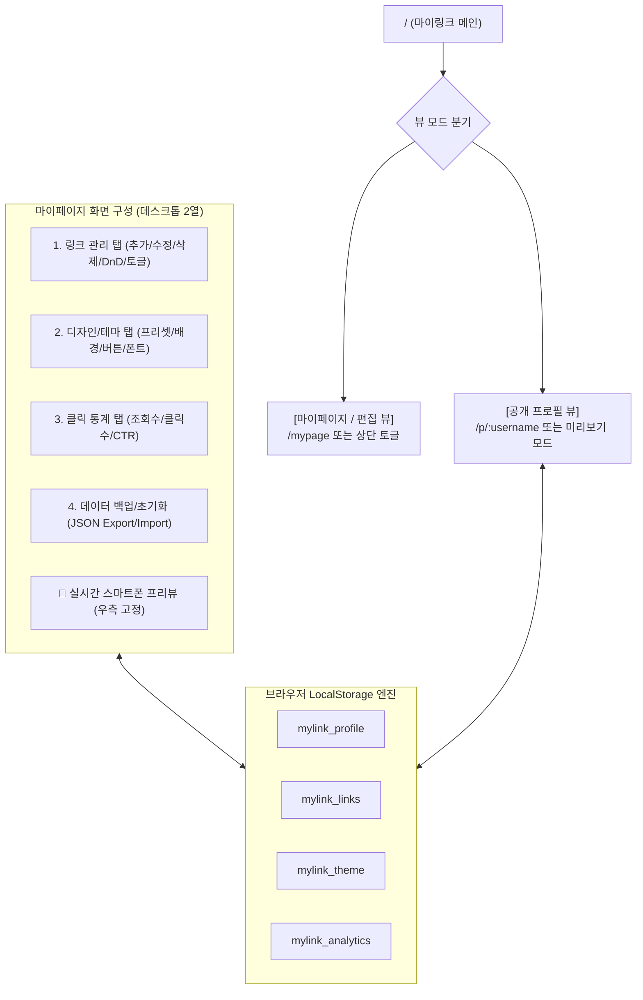

# [마이링크 (MyLink)] 로컬스토리지 기반 기능 정의서 (Functional Specification)

- **버전**: v1.1.0 (LocalStorage Architecture)
- **작성일**: 2026-11-09
- **서비스명**: 마이링크 (MyLink) — 브라우저 로컬스토리지 기반 링크트리(Linktree) 클론 웹 애플리케이션
- **아키텍처**: 완전한 클라이언트 사이드(Client-Side) 구동 — 별도 DB/백엔드 서버 없이 브라우저 `localStorage`를 데이터 저장소로 활용

---

## 1. 프로젝트 개요 (Overview)

### 1.1 서비스 목적 및 방향성
**마이링크(MyLink)**는 별도의 데이터베이스나 복잡한 백엔드 서버 구축 없이, 사용자의 브라우저 **로컬스토리지(LocalStorage)**를 활용하여 링크 등록, 실시간 미리보기, 감각적인 테마 커스터마이징, 클릭 통계 집계까지 한 번에 동작하도록 설계된 **스탠드얼론(Standalone) 링크트리 클론 서비스**입니다.

### 1.2 핵심 특징 및 장점
1. **Zero-Setup & 즉시 실행**: 외부 DB(PostgreSQL/Supabase 등) 설정이나 회원가입 절차 없이 브라우저 접속 즉시 사용 가능
2. **오프라인 및 로컬 영속성**: 브라우저를 닫거나 새로고침해도 로컬스토리지에 데이터가 안전하게 보존
3. **초경량 & 초고속 응답**: 네트워크 대기 시간 없이 실시간으로 좌측 편집과 우측 스마트폰 프리뷰가 0ms 지연으로 동기화
4. **데이터 백업 및 복원**: JSON 파일로 내 링크트리 데이터를 내보내기(Export)하거나 가져오기(Import) 가능
5. **원클릭 샘플 데이터**: 처음 접속한 사용자를 위해 기본 프로필과 링크가 채워진 샘플 데이터 제공

---

## 2. 화면 및 페이지 구조 (Page & View Flow)

단일 웹 애플리케이션 내에서 **[마이페이지(편집 모드)]**와 **[공개 프로필(최종 사용자 뷰)]**의 2가지 핵심 뷰를 제공합니다.



---

## 3. 로컬스토리지 데이터 스키마 (Data Schema)

로컬스토리지에 JSON 직렬화(`JSON.stringify` / `JSON.parse`) 형태로 저장되는 4가지 핵심 키(Key) 명세입니다.

### 3.1 `mylink_profile` (프로필 정보)
```typescript
interface MyLinkProfile {
  username: string;       // 고유 핸들 (예: "seoyeon")
  displayName: string;    // 표시 이름 (예: "김서연")
  bio: string;            // 한 줄 소개글
  avatarUrl: string;      // 프로필 이미지 URL 또는 base64
  isOnline: boolean;      // 온라인 상태 뱃지 표시 여부
  socialLinks: {          // SNS 아이콘 링크 모음
    instagram?: string;
    github?: string;
    twitter?: string;
    youtube?: string;
    email?: string;
  };
  updatedAt: string;      // ISO 8601 타임스탬프
}
```

### 3.2 `mylink_links` (링크 목록)
```typescript
interface MyLinkItem {
  id: string;             // 고유 ID (uuid 또는 nanoid)
  type: 'link' | 'header';// 일반 링크 버튼 or 섹션 구분 제목
  title: string;          // 버튼 텍스트 또는 헤더 타이틀
  url: string;            // 대상 URL (type === 'link' 일 때)
  isActive: boolean;      // 노출 활성화(ON/OFF) 여부
  orderIndex: number;     // 노출 정렬 순서
  createdAt: string;
}

type MyLinkList = MyLinkItem[];
```

### 3.3 `mylink_theme` (디자인 및 테마 설정)
```typescript
interface MyLinkTheme {
  presetId: 'toss' | 'brutalism' | 'minimal-dark' | 'pastel' | 'retro-window' | 'paper';
  bgType: 'color' | 'gradient';
  bgValue: string;        // 배경 헥사코드 또는 CSS 그라디언트 문자열
  buttonStyle: 'fill' | 'outline' | 'shadow' | 'glass'; // 버튼 형태
  buttonRadius: 'sharp' | 'rounded' | 'pill';          // 0px | 14px | 999px
  buttonBgColor: string;  // 버튼 배경색
  buttonTextColor: string;// 버튼 글자색
  fontFamily: 'Pretendard' | 'SF Pro' | 'Serif' | 'Monospace';
}
```

### 3.4 `mylink_analytics` (방문 및 클릭 통계)
```typescript
interface MyLinkAnalytics {
  totalViews: number;               // 총 프로필 조회수
  totalClicks: number;              // 총 링크 클릭수
  linkClicks: Record<string, number>; // { [linkId]: 클릭수 }
  lastViewedAt: string;
}
```

---

## 4. 기능 요구사항 명세 (Functional Requirements)

### 4.1 [FR-01] 링크 및 콘텐츠 블록 관리 (Link Management)
| 요구사항 ID | 기능명 | 상세 내용 |
|---|---|---|
| **FR-01-01** | 링크 블록 추가 | '새 링크 추가' 버튼 클릭 시 즉시 새 카드 생성, `mylink_links`에 추가 |
| **FR-01-02** | 실시간 인라인 편집 | 제목(Title), URL 입력 필드 변경 시 로컬스토리지에 `debounce(300ms)`로 자동 저장 |
| **FR-01-03** | 노출 ON/OFF 토글 | 스위치 토글로 링크를 삭제하지 않고 임시 숨김 처리 (`isActive` 값 갱신) |
| **FR-01-04** | 드래그 앤 드롭 정렬 | 마우스 드래그로 순서 변경 시 `orderIndex` 재계산 및 로컬스토리지 자동 반영 |
| **FR-01-05** | 섹션 구분 헤더 블록 | 링크 카드들 사이에 영역을 구분짓는 '텍스트 헤더 블록' 추가 지원 |
| **FR-01-06** | 링크 삭제 | 휴지통 아이콘 클릭 시 확인 후 로컬스토리지에서 해당 항목 제거 |

---

### 4.2 [FR-02] 디자인 테마 및 비주얼 커스텀 (Appearance & Customization)
| 요구사항 ID | 기능명 | 상세 내용 |
|---|---|---|
| **FR-02-01** | 6종 원클릭 프리셋 | 1. **토스 미니멀**: 화이트/라이트그레이 배경 + 토스 블루(#3182F6) 포인트<br>2. **네오브루탈리즘**: 옐로우 배경 도트 패턴 + 두꺼운 3px 블랙 보더 & 하드 섀도우<br>3. **미니멀 다크**: 올블랙/차콜 배경 + 은은한 다크 글래스 버튼<br>4. **파스텔 선셋**: 퍼플-핑크 부드러운 그라디언트<br>5. **레트로 윈도우**: 윈도우 상단 바(신호등 닷) + 클래식 UI<br>6. **에어리 페이퍼**: 편안한 아이보리 질감의 매거진 스타일 |
| **FR-02-02** | 배경 커스텀 | 프리셋 외에 단색 컬러 피커 또는 그라디언트 프리셋을 직접 선택 가능 |
| **FR-02-03** | 버튼 스타일 & 굴곡 | - 라운드: 각진 모서리(0px), 부드러운 둥글기(14px), 풀 필(999px)<br>- 스타일: 기본 채우기(Fill), 테두리선(Outline), 볼드 그림자(Brutalism) |
| **FR-02-04** | 프로필 아바타 변경 | 이미지 파일 업로드 시 `FileReader`를 통해 base64 또는 로컬 Blob URL로 저장 |

---

### 4.3 [FR-03] 실시간 스마트폰 프리뷰 (Live Mobile Preview)
| 요구사항 ID | 기능명 | 상세 내용 |
|---|---|---|
| **FR-03-01** | 데스크톱 2열 레이아웃 | - **좌측 (55%)**: 링크, 테마, 프로필, 통계 편집 설정 폼<br>- **우측 (45%)**: 실시간 스마트폰 프레임(375×740px 비율) 뷰어 고정 |
| **FR-03-02** | 무지연 즉각 반영 | React State와 연동되어 타이핑, 색상 변경, 순서 변경 시 0초 딜레이로 우측 폰 화면 갱신 |
| **FR-03-03** | 모바일 반응형 프리뷰 | 화면 너비 840px 이하 환경에서는 우측 뷰어가 하단 플로팅 '미리보기' 버튼으로 전환되며, 클릭 시 바텀 시트로 프리뷰 제공 |
| **FR-03-04** | 링크 클릭 시뮬레이션 | 프리뷰 내부 링크 클릭 시 새 탭으로 URL 열림 + 로컬스토리지 클릭 통계 카운터 실시간 증가 |

---

### 4.4 [FR-04] 클릭 및 방문 통계 (Local Analytics)
| 요구사항 ID | 기능명 | 상세 내용 |
|---|---|---|
| **FR-04-01** | 페이지 조회수(Views) | 공개 프로필 화면이 열릴 때마다 `totalViews` 카운터 1 증가 |
| **FR-04-02** | 링크 클릭수(Clicks) | 각 링크 버튼을 클릭할 때마다 해당 링크의 `clickCount` 및 전체 `totalClicks` 증가 |
| **FR-04-03** | 클릭률(CTR) 지표 | `(총 클릭 수 / 총 조회수) * 100` 수치를 %로 마이페이지 통계 카드에 표시 |
| **FR-04-04** | 링크별 개별 클릭 뱃지 | 링크 관리 목록 각 카드 우측에 `12회 클릭 (CTR 15%)` 뱃지 실시간 표시 |
| **FR-04-05** | 통계 초기화 | 통계 탭에서 '통계 데이터 리셋' 버튼 제공 |

---

### 4.5 [FR-05] 데이터 관리 및 백업 (Data Management)
| 요구사항 ID | 기능명 | 상세 내용 |
|---|---|---|
| **FR-05-01** | 기본 샘플 데이터 로드 | 최초 방문 또는 로컬스토리지가 비어있을 때 매력적인 기본 데모 데이터 자동 초기화 |
| **FR-05-02** | JSON 내보내기 (Export) | 현재 프로필, 링크, 테마 설정을 단일 `.json` 파일로 다운로드 백업 |
| **FR-05-03** | JSON 가져오기 (Import) | 백업해 둔 `.json` 파일을 업로드하여 기존 데이터를 덮어쓰고 즉시 복원 |
| **FR-05-04** | 초기화 (Reset) | 클릭 한 번으로 모든 데이터를 지우고 기본 샘플 상태로 되돌리는 기능 |

---

## 5. 테크 스택 (Tech Stack)

- **프레임워크**: Next.js 16.4 (App Router) + React 19 + TypeScript
- **스타일링**: Tailwind CSS v4 + 인라인 CSS 변수(동적 테마 연동)
- **상태 및 스토리지 관리**: React Custom Hooks (`useLocalStorage`, `useProfile`, `useLinks`)
- **드래그 앤 드롭**: HTML5 Drag & Drop API 또는 경량 모듈
- **아이콘**: 경량 인라인 SVG (TDS & Lucide 스타일)
- **폰트**: Pretendard Variable (기본 웹폰트)

---

## 6. 개발 단계별 구현 계획 (Milestones)

1. **Step 1: 로컬스토리지 어댑터 및 기본 Mock 데이터 구축**
   - `useLocalStorage` 훅 및 스키마 인터페이스 정의
   - 기본 샘플 데이터(기본 프로필, 3개 링크, 토스 테마) 세팅

2. **Step 2: 마이페이지 2열 레이아웃 & 실시간 스마트폰 프리뷰 컴포넌트**
   - 데스크톱: 좌측 편집 패널 + 우측 스마트폰 디바이스 목업 뷰어
   - 모바일: 반응형 탭 및 바텀시트 프리뷰

3. **Step 3: 링크 관리 (CRUD, ON/OFF, 순서 변경)**
   - 링크 추가, 수정, 삭제, 토글 기능 구현
   - 인라인 저장 및 프리뷰 즉시 연동

4. **Step 4: 테마 커스터마이징 엔진 (6종 프리셋 & 컬러 피커)**
   - 토스, 네오브루탈리즘, 다크 등 6종 테마 즉시 교체
   - 버튼 모양, 배경색 커스텀 반영

5. **Step 5: 로컬 통계 집계 & 데이터 내보내기/가져오기 (JSON Export/Import)**
   - 클릭 및 조회수 카운트
   - JSON 백업/복원 기능으로 로컬스토리지 보존성 완성
